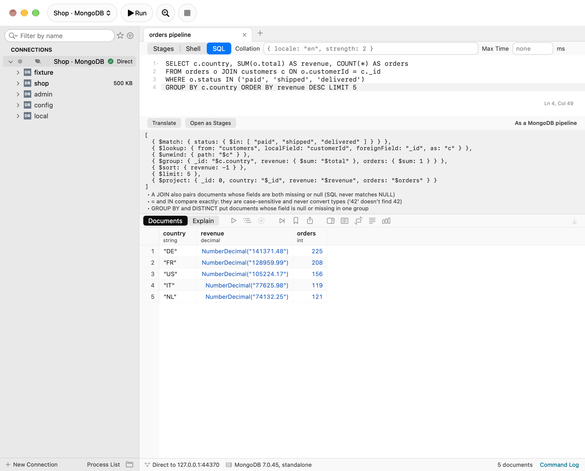
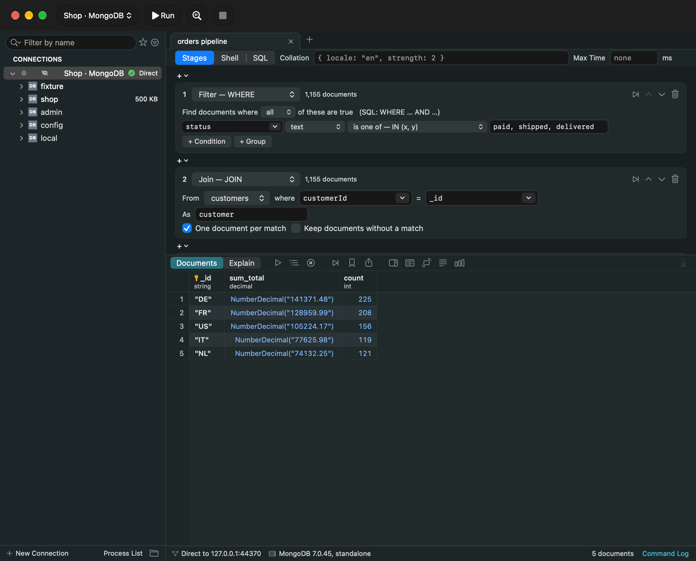
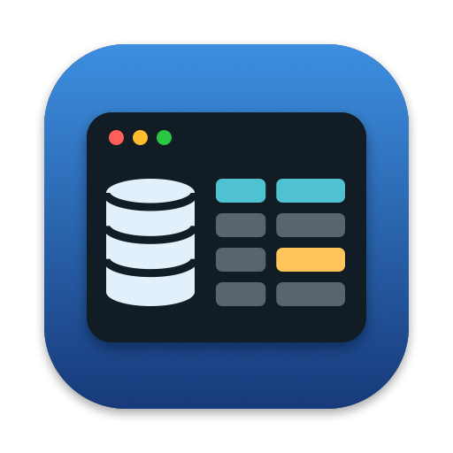
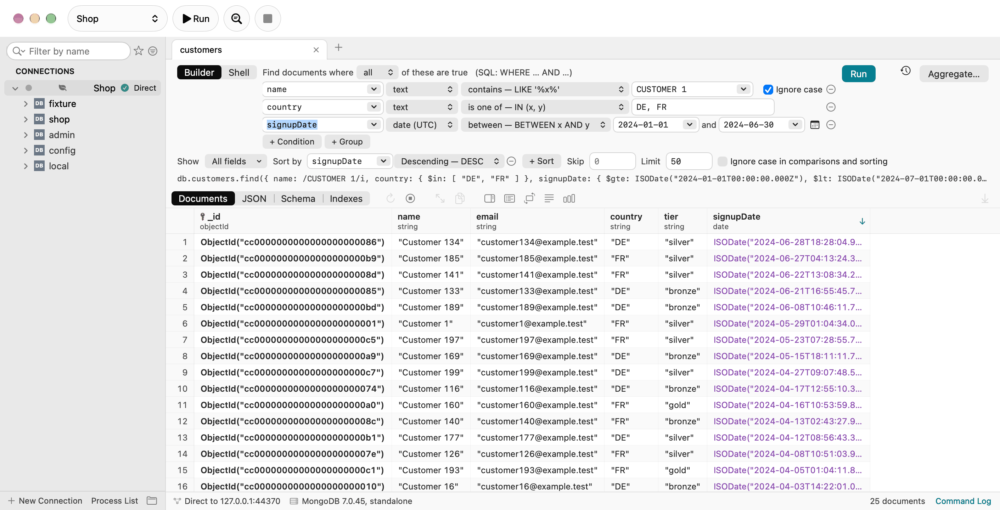
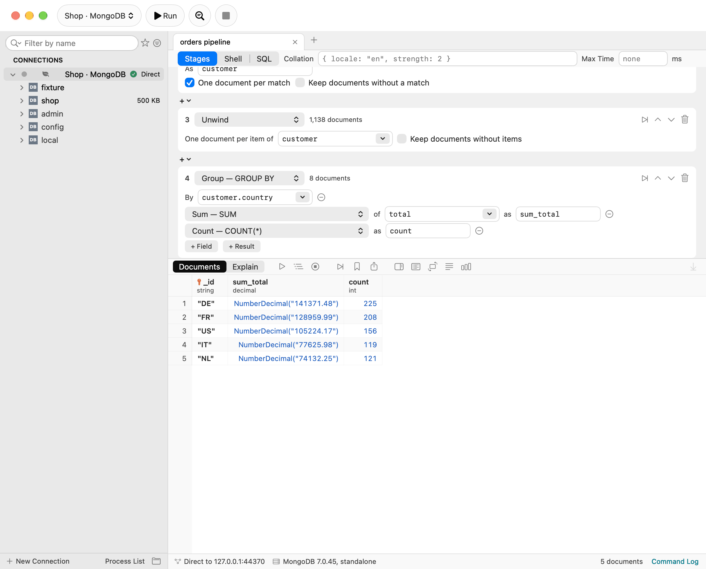
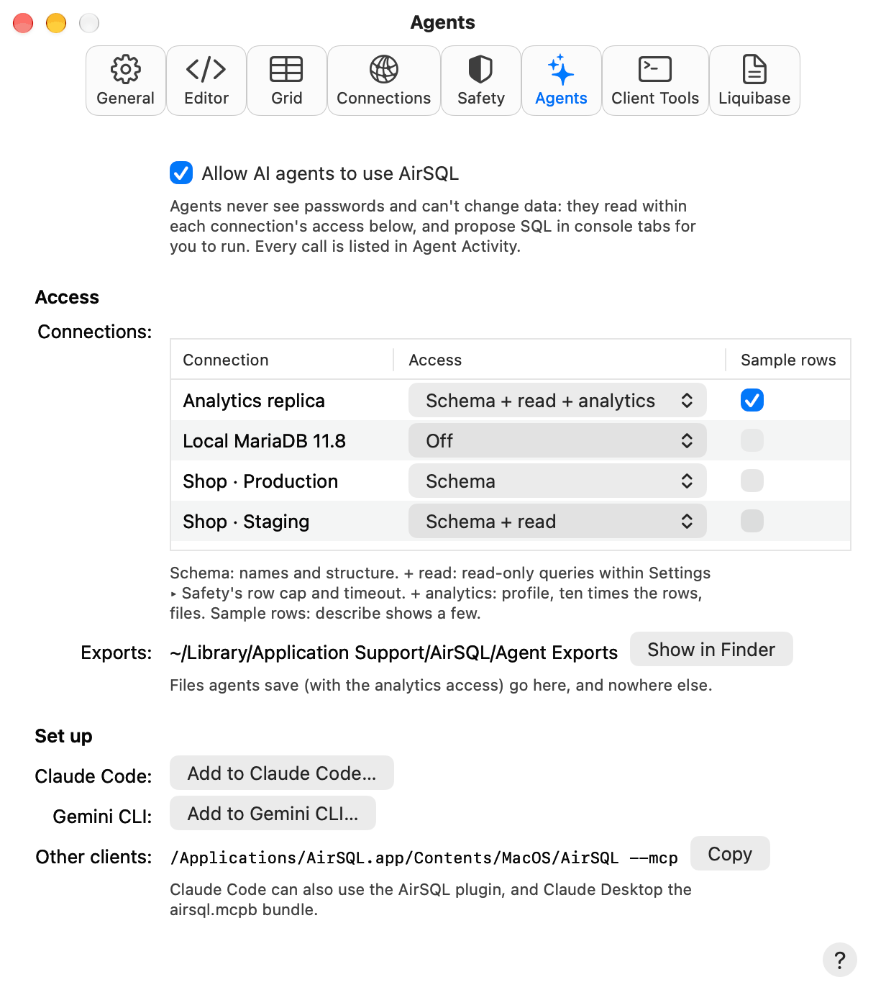
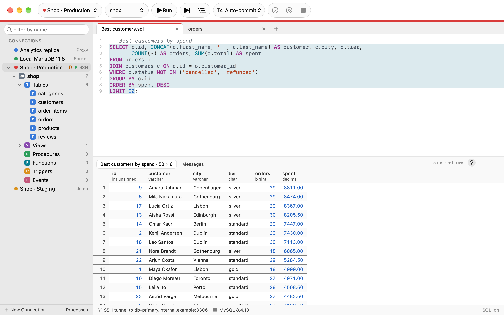
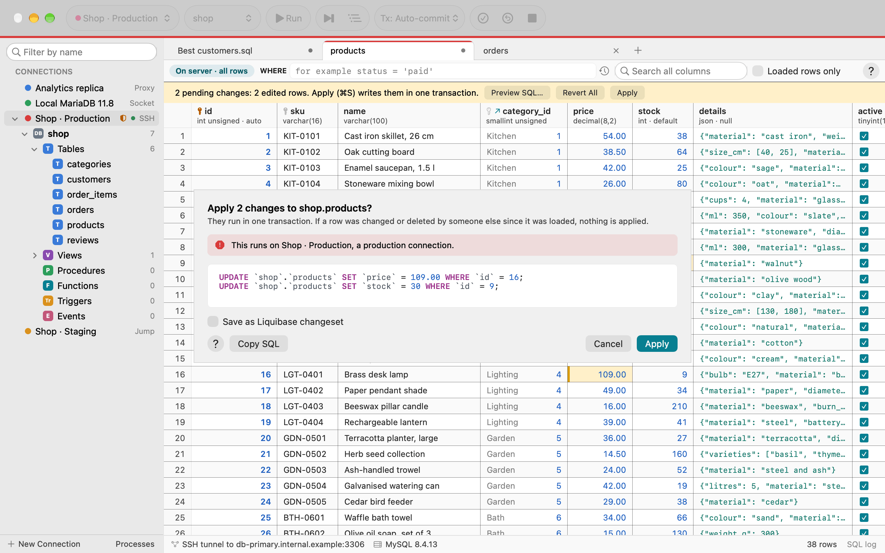
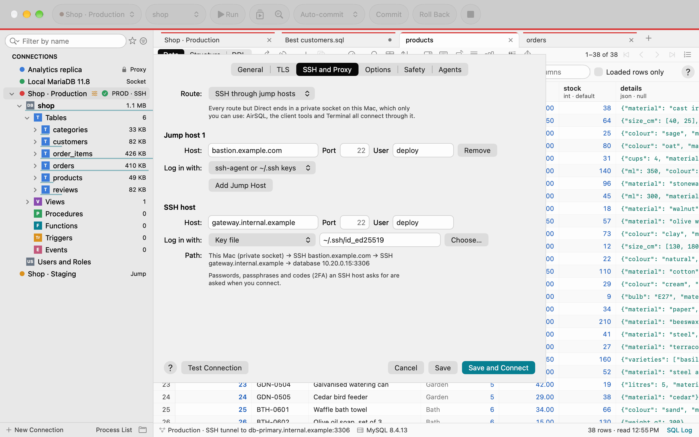
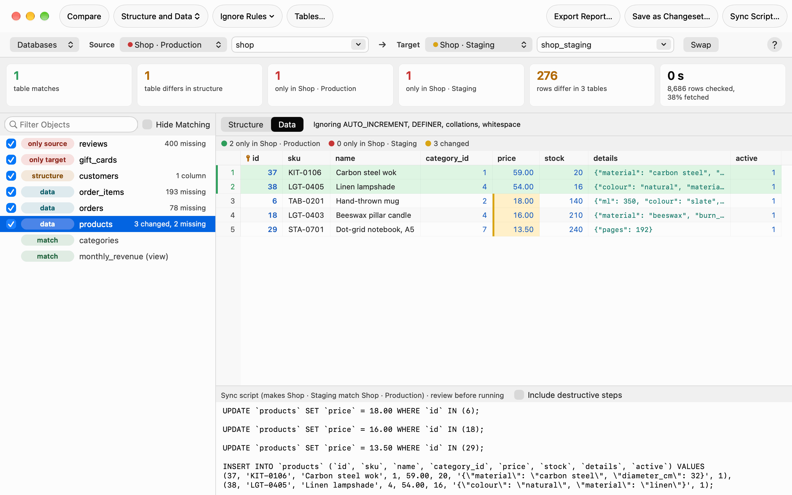

<p align="center">
  
  
</p>

<h1 align="center"> AirSQL</h1>

<p align="center"><b>One native Mac app for MySQL, MariaDB and MongoDB.<br>
Write SQL against MongoDB. Join and group without learning <code>$lookup</code>. Let AI agents read your data, never
write it behind your back.<br>Free and open source.</b></p>

<p align="center">
  <a href="https://github.com/kleash/airsql/actions/workflows/ci.yml?query=branch%3Amain"></a>
  <a href="https://github.com/kleash/airsql/actions/workflows/codeql.yml?query=branch%3Amain"></a>
  <a href="https://github.com/kleash/airsql/actions/workflows/security.yml?query=branch%3Amain"></a>
  <a href="https://scorecard.dev/viewer/?uri=github.com/kleash/airsql"></a>
  <a href="https://github.com/kleash/airsql/blob/main/LICENSE"></a>
  <a href="https://github.com/kleash/airsql/releases/latest"></a>
</p>

```sh
brew install --cask kleash/tap/airsql
```

## Why people switch

<table>
  <tr>
    <td width="50%"><br><b>SQL on MongoDB.</b> Type <code>SELECT … JOIN … GROUP BY</code>; get the pipeline, its results, and notes where MongoDB differs from SQL.</td>
    <td width="50%"><br><b>Filters without the syntax.</b> Field, operator, value: contains, is one of, between, date ranges. It writes the <code>find</code> for you, and shows it.</td>
  </tr>
  <tr>
    <td width="50%"><br><b>Joins and group-bys as cards.</b> Filter, Join, Group, Sort: each stage a form, with a count per stage and warnings when a join can't match.</td>
    <td width="50%"><br><b>AI agents, on a leash.</b> Claude Code, Gemini CLI or Claude Desktop over MCP: read-only checks, changes wait for your OK, never your passwords.</td>
  </tr>
  <tr>
    <td width="50%"><br><b>A SQL editor that reads your SQL.</b> Completion that knows aliases and joins, checks as you type, rename, a formatter, a session per tab.</td>
    <td width="50%"><br><b>Edits you can trust.</b> Nothing is written until Apply; you see every statement first, and Apply checks it touched exactly those rows.</td>
  </tr>
  <tr>
    <td width="50%"><br><b>Every way in.</b> SSH, jump hosts, HTTP and SOCKS proxies, your <code>~/.ssh/config</code>, replica sets and <code>mongodb+srv</code>; TLS checked against the real name.</td>
    <td width="50%"><br><b>Compare and sync.</b> Two servers, databases or tables, structure and rows, with a script you review before it runs.</td>
  </tr>
</table>

Also: EXPLAIN as a tree and a flame graph, a fast grid with charts and heatmaps, users and roles, Disk Usage, the table
editor and ER diagrams, Liquibase changesets, dump and restore, Watch Changes on a replica set, and import from Sequel
Ace, TablePlus, DBeaver, Workbench and HeidiSQL. Native AppKit, light and dark, a shortcut for everything, Apple silicon
and Intel, macOS 13.1+, no account. Every picture is also in dark mode in
[docs/assets/screenshots](docs/assets/screenshots); [AirSQL Help](https://kleash.github.io/airsql/) has the rest.

## Install

`brew install --cask kleash/tap/airsql`, or the zip from [Releases](https://github.com/kleash/airsql/releases).
Signed with a Developer ID and notarized by Apple; every release has its SHA-256, an SBOM and signed build provenance
([check a download](SECURITY.md#check-a-download)).

## Security in brief

Passwords stay in your Keychain, never in files, logs or what agents see. TLS is verified against the server's real
name. Tunnels end in private Unix sockets, never network ports. Nothing is written without Run or Apply, and a lost
connection is never reconnected behind your back. Report a vulnerability privately: [SECURITY.md](SECURITY.md).

## Build from source

```sh
./build.sh --native   # build/AirSQL.app for this Mac; the Command Line Tools are enough, no Xcode
./test.sh             # the tests (Swift 6)
```

[Contributing](CONTRIBUTING.md) · [Report a problem](https://github.com/kleash/airsql/issues/new) ·
[Code of conduct](CODE_OF_CONDUCT.md) · For agents: [llms.txt](docs/llms.txt), [AGENTS.md](AGENTS.md) · Apache 2.0
([LICENSE](LICENSE), [NOTICE](NOTICE))
