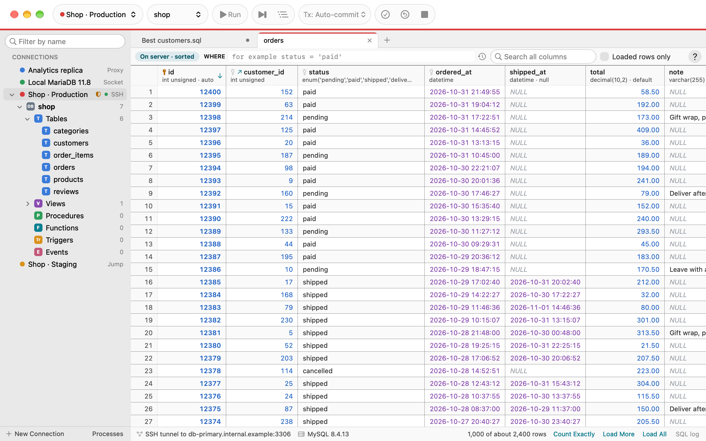

# AirSQL Help

AirSQL is a Mac app for MySQL and MariaDB.

More pictures: the [README](https://github.com/kleash/airsql#screenshots).

- [Install AirSQL](install.md): with Homebrew or from the download.
- [Getting started](getting-started.md): add a connection, find your way around the window.
- [Settings](settings.md): the look, the editor and grid, connections, safety checks, agents, client tools and
  Liquibase.
- [Check SQL before it runs](sql-preview.md): the sheet that shows every change first.
- [Trust a server](trust-a-server.md): servers whose certificate macOS doesn't know.
- [The SQL log](sql-log.md): every statement AirSQL sends, with passwords masked.
- [Read-only queries](read-only-queries.md): what an agent's query, or a read-only connection, may run, and why one is
  refused.
- [The SQL console](console.md): write and run SQL, results, transactions, history and the SQL log.
- [Connections and routes](connections.md): add and edit connections, SSH tunnels, jump hosts, proxies and folders.
- [Browse a server](navigator.md): the tree, the database view, table commands, find text and the process list.
- [A table's rows](table-data.md): load, filter, search, sort, edit, apply, copy and export a table's rows.
- [Read the data in a grid](data-grid.md): the status bar's figures, the value panel, Record View, Transpose, Display
  As, heatmaps, View As, charts and Column Summary, in a table's rows and a query's results.
- [Change tables, views and routines](editors.md): the table editor, views and routines as CREATE code, and the ER
  diagram.
- [Export, restore, copy and import](client-tools.md): your mysqldump and mysql, or AirSQL's own export and runner; copy
  to another server; import from CSV, Excel, JSON and the clipboard, into a new table if you want.
- [Compare two databases](compare.md): structure and data, side by side, and a sync script you review first; or two
  results, or a result with a table, row by row.
- [AI agents](agents.md): let Claude Code, Gemini CLI or Claude Desktop read your schemas and run read-only queries, at
  the access you choose.
- [Liquibase changelogs](liquibase.md): a database as formatted SQL changesets, and any change saved as one.
- [Keyboard shortcuts](shortcuts.md): every command's shortcut.
- [Accessibility](accessibility.md): VoiceOver, the keyboard, motion and text size.
- [Privacy and security](privacy-security.md): what AirSQL connects to, where passwords are kept, what agents may do.
- [Troubleshooting](troubleshooting.md): when a connection fails, and how to report a problem.

Every button and menu command says what it does when you hold the pointer over it.
